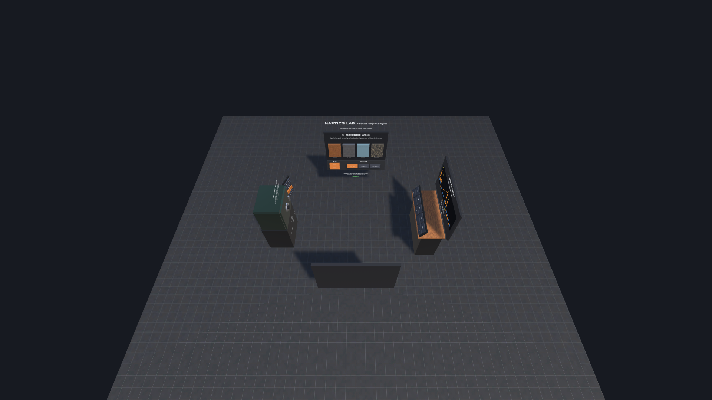
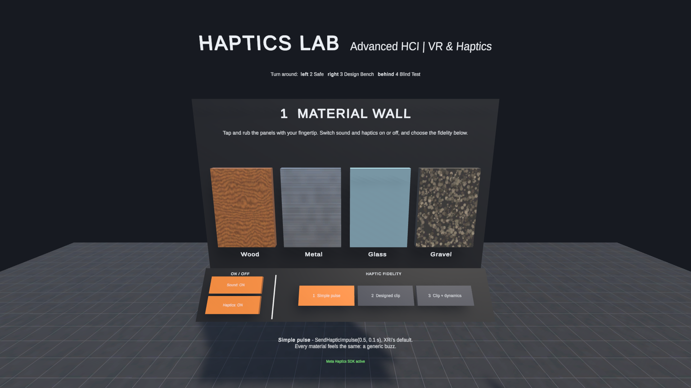
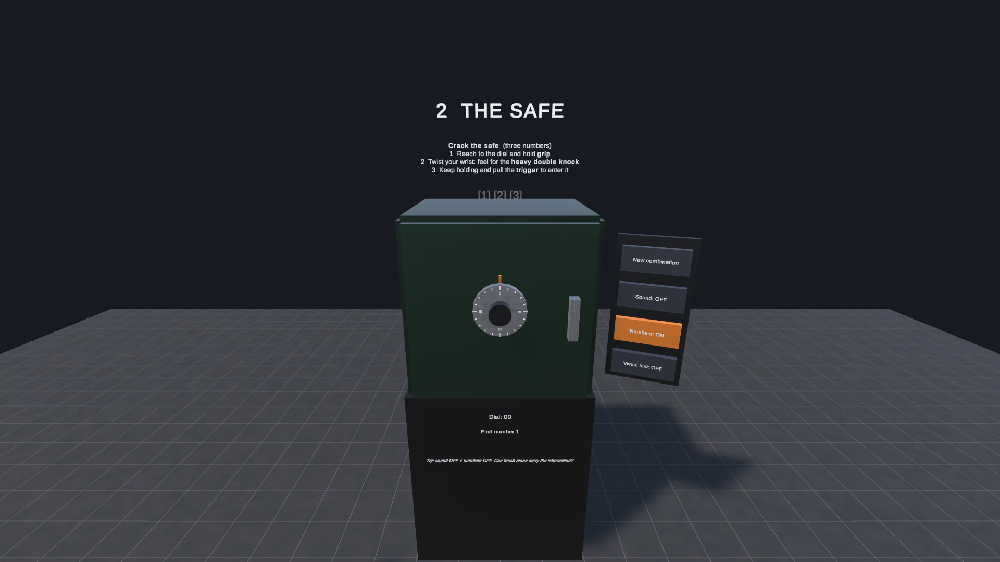
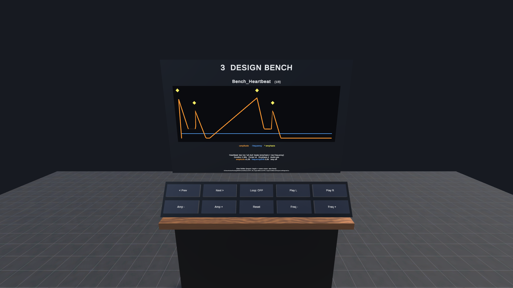
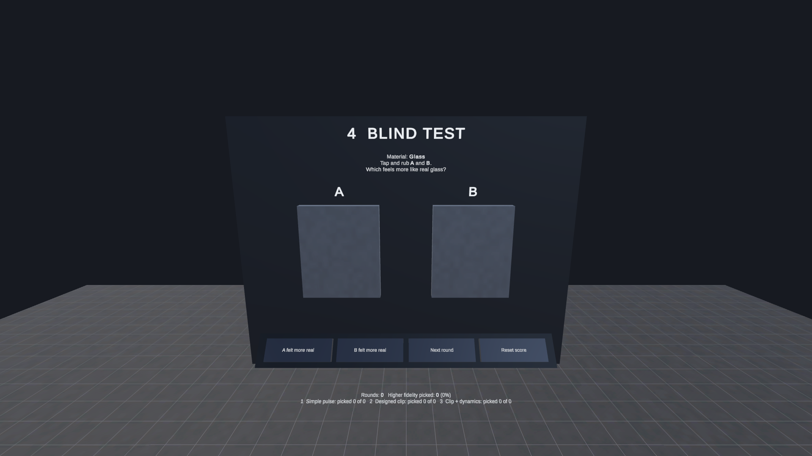
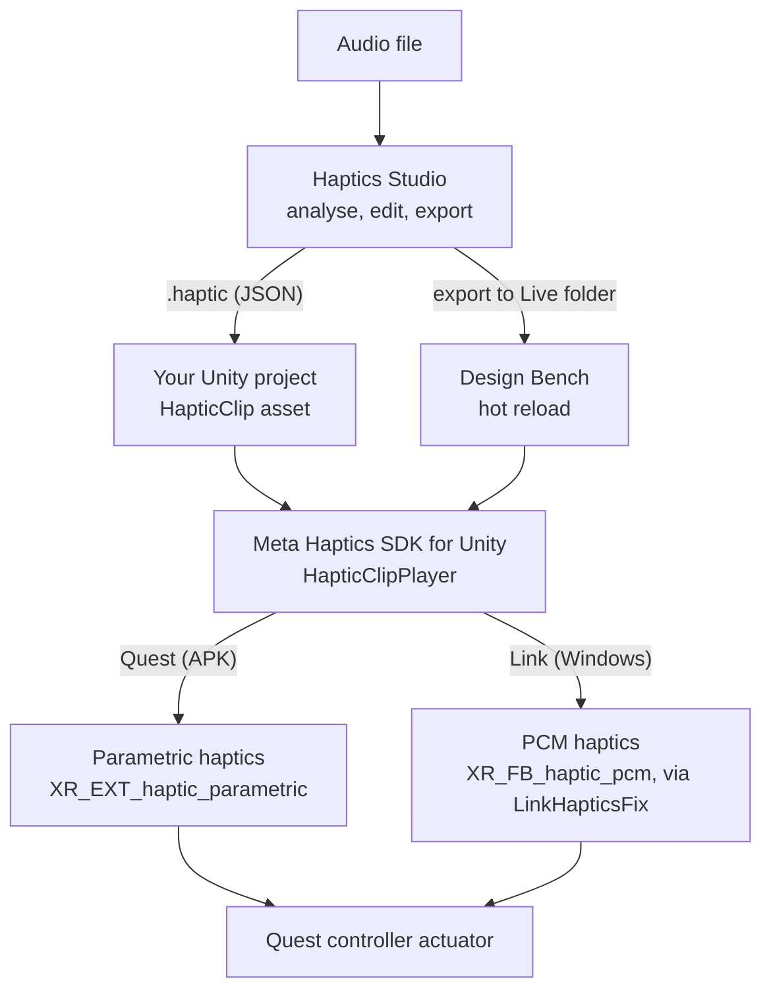

# 🖐️ Haptics Lab: Advanced HCI (VR & Haptics)

A small VR lab for **Meta Quest 2 / 3 / 3S** that shows what haptic feedback can add to an interaction, and how to put it into your own Unity project with the open-source **[Haptics Studio](https://github.com/facebook/haptics-studio)**.

Made for the guest lecture *VR and Haptics* in **Advanced Human-Computer Interaction**, Aalborg University Copenhagen (November 2026).

| | |
|---|---|
| Unity | **6000.6.7f1** (Unity 6.6), URP |
| Interaction | XR Interaction Toolkit **3.6.1** + OpenXR 1.18 (XRI 3.2 and older do not compile on Unity 6.6) |
| Haptics | Meta XR Haptics SDK **207** (`com.meta.xr.sdk.haptics`) for `.haptic` clips, XRI `HapticImpulsePlayer` for simple pulses |
| Design tool | Haptics Studio (MIT, open source) or Meta's build of it, *Meta Haptics Studio* |
| Run | Play mode over **Meta Horizon Link** (Windows), or the ready-made **[APK](https://github.com/luialbaekthomsen/AdvancedHCI_HapticsLab/releases/latest)** on the headset |

---



## The four zones

You stand in the middle, and each zone sits in one direction.

| | Zone | What you do | What it shows |
|---|---|---|---|
| ⬆️ front | **1 Material Wall** | Tap and rub wood, metal, glass and gravel with your fingertip. Switch sound and haptics on or off, and choose one of three haptic fidelity levels. | How much each step adds: **Simple pulse → Designed clip → Clip + dynamics**. Sound is the same at every level. Turn it off to feel the haptics on their own. |
| ⬅️ left | **2 The Safe** | Crack a 3-number combination by *feeling* for the heavy double knock on the dial. | Haptics as an **information channel**. Sound starts off, and the knock sounds like every other number, so only touch gives it away. Turn the numbers off too. |
| ➡️ right | **3 Design Bench** | Browse example clips, or export your own from Haptics Studio into the *Live* folder: it shows up in VR within a second. Play it on either hand and change its strength and frequency. | The **design → feel → iterate** loop, and the `HapticClipPlayer` API (amplitude, frequency shift, looping). |
| ⬇️ behind | **4 Blind Test** | Two identical-looking panels with hidden fidelity levels. Vote for the one that feels more real. | A mini **A/B perception study**, with a running score to discuss in groups. |

### The three fidelity levels on the Material Wall

| Level | Tap | Rub |
|---|---|---|
| **1 Simple pulse** | `SendHapticImpulse(0.5, 0.1 s)`, XRI's default, the same for every material | the same buzz for every material |
| **2 Designed clip** | a `.haptic` clip per material: a dull knock for wood, a ringing strike for metal, … | a looping texture clip per material, at a fixed tempo |
| **3 Clip + dynamics** | the same clip, stronger the harder you hit | **follows your finger:** one short "grain" per ridge you cross. Slow = separate ridges, fast = a dense buzz, stop = nothing |

| Material Wall | The Safe |
|---|---|
|  |  |
| **Design Bench** | **Blind Test** |
|  |  |

---

## Before the lecture (do this at home)

Downloads and the first import take a long time. Please do this **before** class, so the lab time is spent on haptics. There are two ways to run the lab; choose one.

**A. In Unity over Meta Horizon Link** (Windows; needed if you want to change the lab or design your own clips in it), about 1 hour, mostly waiting:

1. **Unity Hub → Installs → Install Editor → 6000.6.7f1.** You only need *Android Build Support* if you want to build an APK yourself.
2. **Meta Horizon Link** app (Windows): install it, connect your headset once and check that Link starts.
3. **Haptics Studio:** install Meta's packaged build, *Meta Haptics Studio* (Windows or Mac).
4. **Clone this repo and follow [Setup](#setup-first-time-about-10-min).** You are ready when you press Play, see the Material Wall in the headset, and the status line under it says *Meta Haptics SDK active*.

**B. The ready-made APK on the headset** (any computer, including Mac; no Unity needed), about 15 minutes: see [Install the APK](#install-the-apk-no-unity-needed).

For both: turn on **developer mode** on the headset (Meta Horizon phone app → Devices → your headset → Headset settings → Developer mode), charge the headset and both controllers, and bring a USB-C cable.

> **Mac users:** Meta Horizon Link only runs on Windows. Use the APK (B), or team up with a group that has a Windows laptop.

## In class

| Block | What you do |
|---|---|
| Break before hands-on | Start the lab (Unity + Link, or the APK). Checkpoint: you see the Material Wall. |
| Hands-on 1 (45 min) | The four zones. Swap who wears the headset about every 10 minutes. |
| Hands-on 2 (25 min) | Pick one interaction from **your own VR project**, design a clip for it in Haptics Studio, export it to the Live folder and feel it on the Design Bench. Write down which event should trigger it in your project. |
| After class | Add the clip to your own project: see [Use it in your own project](#use-it-in-your-own-project). |

---

## Setup (first time, about 10 min)

1. **Clone** this repo and open it with Unity **6000.6.7f1** (Unity Hub → *Add project from disk*). The first import takes several minutes (*Rebuilding Library…*).
   - Meta's packages may show a few prompts on first open: accept *Enable Meta XR Feature Set*, close the welcome window, and choose what data to share.
   - Without the *Android Build Support* module, Unity may show an *Android SDK not found* dialog. Click OK: Link play mode doesn't need it.
2. Open **`Assets/HapticsLab/Scenes/HapticsLab.unity`**.
3. Start **Meta Horizon Link** on the PC and in the headset (cable or Air Link). In the Link app on the PC, make sure Meta Horizon Link is the **active OpenXR runtime** (*Settings → General → OpenXR Runtime*).
4. Press **Play** in Unity.

Everything else (OpenXR, controller profiles, Meta XR feature, Direct3D 11, Multi Pass rendering for Link) is already configured in the project.

> ⚠️ **Don't click *Fix All*** in *Project Validation* or Meta's *Project Setup Tool*. The optional items listed there can switch the Windows render mode back to *Single Pass Instanced*, and the lab is set up for *Multi Pass* over Link. Required items are already fixed.

The **Haptics Lab** menu also has *1. Set Up Project* and *2. Build Lab Scene*. You don't need them for this repo; they rebuild the setup and the scene from code (for example after changing the scene builder).

---

## Install the APK (no Unity needed)

The ready-made APK is attached to the **[latest release](https://github.com/luialbaekthomsen/AdvancedHCI_HapticsLab/releases/latest)**. It runs on the headset itself, with the full Meta Haptics SDK.

1. Turn on **developer mode** (see [Before the lecture](#before-the-lecture-do-this-at-home)) and connect the headset to your computer with USB. In the headset, allow USB debugging when asked.
2. Install the APK with one of:
   - **Meta Quest Developer Hub** (Meta's free desktop app, Windows/Mac): select your device and drag the `.apk` onto it.
   - **[SideQuest](https://sidequestvr.com/setup-howto)**: *Install APK file from folder* (the box-with-arrow icon).
   - **Command line:** `adb install -r HapticsLab-v1.0.apk`
3. In the headset: **Library → filter *Unknown sources* → Haptics Lab**.

To use your own clips on the headset, copy the exported `.haptic` (and a same-name `.wav`) to `Android/data/dk.aau.advancedhci.hapticslab/files/Live` on the headset, for example with Meta Quest Developer Hub's file manager.

### Build the APK yourself
Needs the *Android Build Support* module. **File → Build Profiles → Android → Switch Platform**, connect the headset (developer mode, USB), then **Build And Run**.

---

## Controls

| Action | How |
|---|---|
| Touch / rub a surface | Touch it with the **cyan fingertip sphere** at the front of the controller |
| Press a button | **Push** the fingertip into it (brushing past does not count) |
| Grab the dial or the gold bar | Reach to it and hold **grip** |
| Enter a number on the safe | Keep holding the dial and pull the **trigger** |
| Move / turn | Left stick / right stick (snap turn), for example when seated |

There is no pointer ray: everything is within reach.

---

## Design your own haptics (Design Bench)

1. Get **Haptics Studio**: install Meta's packaged build, *Meta Haptics Studio* (quickest), or build the open-source version from [github.com/facebook/haptics-studio](https://github.com/facebook/haptics-studio) (`yarn install && yarn start:dev`).
2. **New project → import an audio file** (.wav/.mp3/.ogg). Studio analyses it and suggests a haptic clip.
3. Shape it: the **amplitude** envelope (strength), the **frequency** envelope (sharp ↔ rumbly) and **emphasis** points (transients, clicks).
4. **Export → .haptic** into the Live folder: in Unity, **Haptics Lab → Open Live Folder** (`Assets/HapticsLab/Haptics/Live`). With the APK, see [Install the APK](#install-the-apk-no-unity-needed).
5. Put a copy of the audio file **with the same name** next to it to hear it too.
6. In VR, the bench selects the new clip and plays it. Use **Play L / Play R** to feel it again, **Amp ±** and **Freq ±** to change it, and **Loop** for continuous clips. Change it in Studio, export again, feel it again.

*Tip:* Haptics Studio can also audition clips on the headset directly through its **companion app** (pairing over Wi-Fi or USB). That is useful while designing; the Live folder is how you feel the clip *in context*.

---

## Use it in your own project

> **Before you start:** commit your project (or work on a branch). Adding packages can trigger upgrades. On Unity 6.6, install XR Interaction Toolkit 3.6+, OpenXR and *Meta XR Haptics SDK* from the Package Manager. On older Unity versions, use the XRI and Haptics SDK versions the Package Manager offers there; the APIs below are the same.

> ⚠️ **Testing over Meta Horizon Link? Copy [`LinkHapticsFix.cs`](Assets/HapticsLab/Scripts/Core/LinkHapticsFix.cs) into your project too.** Without it, `.haptic` clips are silent over Link, with no error (see [Known issue](#known-issue-designed-haptics-over-link)). It only affects Windows; on the Quest itself it isn't compiled.

### Option A: Haptic Audio Feedback (recommended)
One component that plays a haptic effect and a sound together. It does not depend on any other lab code.

1. Copy the folder **`Assets/HapticsLab/Scripts/HapticAudioFeedback/`** (the script and its `.asmdef`) into your project's `Assets`.
2. Select an object with an XRI interactable (for example *XR Grab Interactable*) → **Add Component → Haptics → Haptic Audio Feedback**.
3. Assign a `.haptic` clip and/or a sound, and tick when it should play.

It needs **XR Interaction Toolkit 3**. The **Meta XR Haptics SDK is optional**: if it's installed, `.haptic` clips play through the SDK. Without it, or on platforms where it can't run, the *Simple pulse* settings are used, and the script still compiles.

| Section | Settings |
|---|---|
| What to feel | `.haptic` clip, strength, frequency shift, priority, *or* a simple pulse (amplitude, duration, frequency) |
| What to hear | one or more sounds (a random one each time), volume, pitch variation, 3D or 2D, optional own AudioSource (e.g. Meta XR Audio) |
| When | hover enter/exit, select enter/exit, activate/deactivate, collision (scaled by impact speed), **while held** (loops) |
| While held | loop strength driven by how fast the object moves |
| Hand and timing | hand from the interactor, or always left/right/both; cooldown |
| Events | *On Played*, a UnityEvent that is called every time it plays |

From your own scripts or UnityEvents:

```csharp
var feedback = GetComponent<HapticAudioFeedback>();
feedback.Play();                                        // default hand, full strength
feedback.Play(0.5f);                                    // half strength
feedback.Play(HapticAudioFeedback.Hand.Left, 1f);       // a specific hand
feedback.StartLoop(HapticAudioFeedback.Hand.Right);     // loop until StopLoop()
feedback.StopLoop();

HapticAudioFeedback.GlobalHapticStrength = 0.5f;       // e.g. from a settings slider
HapticAudioFeedback.HapticsEnabled = false;             // haptics off, sound stays on
```

In the lab, the **gold bar** in the Safe uses this component twice: once when you grab it, and once when it hits something. Select it in the Hierarchy to see the settings.

> **Collision feedback on a grabbed object:** set the *XR Grab Interactable*'s **Movement Type** to *Velocity Tracking*. With the default (*Instantaneous*) the object becomes kinematic while held, and Unity reports no collisions with walls or tables.

### Option B: the raw APIs (no lab code)
See `Assets/HapticsLab/Scripts/Examples/MinimalHapticExample.cs`:

```csharp
// Simple haptics (any OpenXR controller, XRI):
hapticImpulsePlayer.SendHapticImpulse(amplitude: 0.5f, duration: 0.1f);

// Designed haptics (.haptic clip from Haptics Studio, Meta Haptics SDK):
var player = new HapticClipPlayer(clip);   // keep and reuse it
player.amplitude = 0.8f;                   // scale strength
player.frequencyShift = 0.2f;              // shift "pitch" (-1..1)
player.isLooping = true;
player.Play(Controller.Right);
...
player.Dispose();
```

Things worth knowing:
- **Clips are not mixed.** Only one clip plays per controller at a time; `priority` (0 = most important) decides which. The Material Wall gives taps priority 20 so they briefly override textures (priority 100).
- **Two ways to render continuous contact.** *Loop* a texture clip and modulate `amplitude` / `frequencyShift` (level 2), or play a short *grain* clip each time the finger travels a set distance (level 3, see `HapticSurface.cs`). The second follows the finger exactly and feels much more physical.
- **Sound and touch belong together**, but sound easily dominates. Keep it quieter than you think, and match loudness across materials.
- **Less is more.** Strong, constant vibration quickly becomes noise. Reserve strong effects for meaningful moments.

---

## How the pieces fit together



- **[`facebook/haptics-studio`](https://github.com/facebook/haptics-studio)**: the design app (Electron + Rust DSP) plus companion apps for Quest, iOS and Android.
- **[`facebook/meta-haptics-sdk`](https://github.com/facebook/meta-haptics-sdk)**: the low-level renderer that turns `.haptic` files into actuator signals, plus the `.haptic` file spec and a Unity PCM example.
- **`.haptic`**: a small JSON file: `signals.continuous.envelopes.amplitude[]` (time, amplitude, optional emphasis) and `frequency[]` (time, frequency), all normalised 0–1.

---

## Project structure

```
Assets/HapticsLab/
  Scripts/HapticAudioFeedback/  ★ the reusable component: copy this folder into your project
  Scripts/Core/          LabHaptics, ClipVoice, Fingertip, LabRig, HapticEnvelope (lab internals),
                         LinkHapticsFix (★ copy this too if you use Link)
  Scripts/UI/            LabButton (pressed with the fingertip, with UI haptics)
  Scripts/Zones/         MaterialWall, HapticSurface, BlindTest, SafeDial, SafeController,
                         DesignBench, LiveClipLibrary, EnvelopeView
  Scripts/Examples/      MinimalHapticExample (raw APIs only)
  Editor/                Setup, scene builder and screenshot tool (menu: Haptics Lab)
  Haptics/               .haptic clips (Live/ = hot-reload folder)
  Audio/                 matching sounds
  Textures/              procedural textures
Screenshots/                made with Haptics Lab → Capture Zone Screenshots
```

## Troubleshooting

| Problem | Fix |
|---|---|
| Designed clips are silent over Link, simple pulses work | Check the Console for *[HapticsLab] Quest Link: parametric haptics disabled…* when pressing Play. If it's missing, `LinkHapticsFix.cs` is not in the project (see [Known issue](#known-issue-designed-haptics-over-link)). |
| No vibration at all | Check the headset is on and the controllers are awake. Check that Meta Horizon Link is the active OpenXR runtime (Link app → Settings → General). |
| Status says *Meta Haptics SDK unavailable* | Windows/Quest only. It can take a few seconds after Play; it retries by itself. |
| Nothing shows in the headset when pressing Play | Is Link running and active in the headset? Is Meta Horizon Link the active OpenXR runtime? |
| Rendering problems over Link | Check *Project Settings → XR Plug-in Management → OpenXR* (Windows tab): *Render Mode* should be **Multi Pass**. |
| A button doesn't react to my finger | Push *into* it, not past it. |
| Console full of `[MetaXRFeature] …` messages and `ErrorFunctionUnsupported` warnings over Link | Normal: Meta's SDK logs its startup, and asks for features (spatial anchors, scene, parametric haptics) that Link doesn't offer. The lab doesn't use them. |
| Console: *[Project Setup Tool] There are … outstanding Optional fixes* | Optional recommendations. Don't click *Fix All* (see [Setup](#setup-first-time-about-10-min)). |
| Console: *Multiple ADB server instances found* | Two Android SDKs on the PC (for example Unity's and Meta Quest Developer Hub's). Harmless for Link; for APK installs, point *Preferences → External Tools → Android SDK* to the one the other tool uses. |
| The APK doesn't appear in the headset's library | Filter the library by *Unknown sources*. |
| Live clip doesn't appear | It must be valid `.haptic` JSON with at least two amplitude points. Check the Console for `[HapticsLab]` messages. |
| Text is missing | Window → TextMeshPro → Import TMP Essential Resources. |

## Known issue: designed haptics over Link

With the Meta XR SDK 207 (tested on a Quest 3S), Meta Horizon Link reports that it supports *parametric* haptics (`XR_EXT_haptic_parametric`), the format the Haptics SDK prefers, but then **rejects every parametric vibration**. The Haptics SDK ignores that error, so `.haptic` clips are silent, with nothing in the Console. Simple pulses still work, and so does the older *PCM* format (`XR_FB_haptic_pcm`).

[`LinkHapticsFix.cs`](Assets/HapticsLab/Scripts/Core/LinkHapticsFix.cs) works around this. On Windows only, it stops the parametric extension from being requested before OpenXR starts, so the Haptics SDK plays the same clips through PCM instead. The Console confirms it on Play: *[HapticsLab] Quest Link: parametric haptics disabled, the Haptics SDK will use PCM.* On the Quest itself (APK) nothing changes. The file can be deleted once Meta fixes the issue.

## Credits & licence

- Code: **MIT** (see `LICENSE`).
- All audio, haptic clips and textures were generated from scratch for this project and are released under the same licence. No third-party assets are included.
- Haptics Studio and the Meta Haptics SDK renderer are © Meta Platforms, MIT-licensed. The *Meta XR Haptics SDK for Unity* package is under the Meta Platforms Technologies SDK licence and is downloaded by the Package Manager, not included here.
